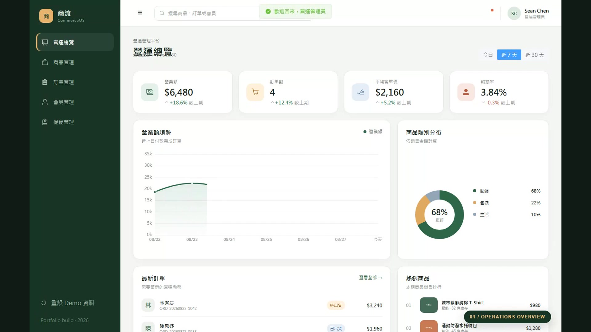

# CommerceOS 電商營運管理平台

一個為前端工程師面試打造的完整 Vue 3 電商後台作品。以真實營運流程為核心，涵蓋商品、SKU、庫存、訂單出貨、會員分群、促銷活動與營運數據，所有操作會透過 IndexedDB 保存在瀏覽器中。

## 45 秒完整流程影片

[](./public/media/commerce-os-interview-demo.mp4)

- 片長：37.27 秒
- 規格：1920 × 1080、H.264、30fps
- 流程：登入 → 營運總覽 → 建立商品 → 9 步表單 → SKU 矩陣 → 圖片上傳 → 發布 → 搜尋訂單 → 出貨 → 會員詳細 → 建立促銷 → 全域搜尋驗證保存資料
- 重新產生：`npm run demo:record`

## 核心功能

- 營運 Dashboard：營業額、訂單數、客單價、轉換率、趨勢圖、類別分布與熱銷排行
- 商品管理：搜尋、分類、狀態、分頁、新增、編輯、上下架及封存
- 九步商品表單：基本資訊、描述、分類、規格、SKU／庫存、物流、SEO、圖片與預覽
- 規格矩陣：依 Color、Size 等選項自動產生所有 SKU 組合
- 圖片管理：拖曳或點擊上傳、本機保存、公開圖片網址
- 訂單管理：搜尋、狀態、日期篩選、分頁、CSV 匯出與訂單詳細
- 履約流程：安排出貨、物流追蹤編號、完成訂單、取消與退貨
- 會員管理：搜尋、分群、累積消費、訂單數與會員詳細抽屜
- 促銷管理：優惠券、滿額活動、折扣活動、期間與啟用狀態
- 全域搜尋：支援商品、SKU、訂單與會員，快捷鍵 `Cmd/Ctrl + K`
- Demo 資料：IndexedDB 持久化及一鍵重設

## 技術棧

- Vue 3、TypeScript、Vue Router、Pinia
- Element Plus、Apache ECharts
- Dexie / IndexedDB
- Vite、ESLint、Vitest
- Playwright、FFmpeg、FFprobe
- GitHub Actions、GitHub Pages

## Demo 登入

```text
帳號：admin@commerce.demo
密碼：demo2026
```

展示模式只驗證欄位是否填寫，不會將帳密傳送至伺服器。

## 本機啟動

```bash
npm install
npm run dev
```

預設網址：<http://127.0.0.1:5173>

## 驗證指令

```bash
npm run lint -- --quiet
npm run typecheck
npm test
npm run build
npm run test:e2e
npm run test:e2e:tablet
npm run demo:record
```

一般 Chromium 與平板尺寸 E2E 會驗證登入、主要管理頁與商品建立流程；錄影測試則會執行完整的資料建立、狀態更新與持久化確認。

## 專案結構

```text
src/
├─ components/       共用層與圖表
├─ data/             Demo seed 與 IndexedDB repository
├─ stores/           Pinia 登入狀態
└─ views/            Dashboard 與各管理頁
tests/               Vitest 單元測試
e2e/                 Playwright 一般驗收與完整錄影流程
scripts/             FFmpeg 後製與影音規格檢查
public/media/        面試影片、封面與 metadata
```

## 部署

推送到 `master` 後，GitHub Actions 會先執行 lint、型別檢查、單元測試與正式 build，再將 `dist` 發布到 GitHub Pages。

預定網址：<https://seanhong1215.github.io/e-commerce-operations-dashboard/>
